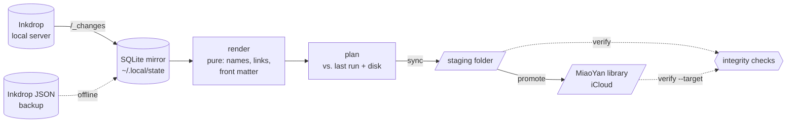

# ink2miao

[](https://github.com/crafts69guy/ink2miao/actions/workflows/ci.yml)


[](LICENSE)

**Move your whole [Inkdrop](https://www.inkdrop.app/) account into a
[MiaoYan](https://github.com/tw93/MiaoYan) library — plain Markdown folders synced by iCloud —
without losing a note, a link, an image, a tag or a date.**

`ink2miao` is a one-way, incremental sync. Keep using Inkdrop while you move. Re-run it as often
as you like, and only what changed is touched. When you are confident, stop using Inkdrop.

```text
$ ink2miao sync
✓ Inkdrop 6.1.4: 563 notes (377 live, 186 deleted)
✓ Applied: 2 updated, 1 moved, 560 unchanged → ~/.local/share/ink2miao/default/staging
$ ink2miao promote
✓ Promoted: 2 copied, 1 moved, 560 unchanged → ~/Library/Mobile Documents/iCloud~com~tw93~miaoyan/Documents
```

## Contents

- [Features](#features)
- [How it works](#how-it-works)
- [Install](#install)
- [Quick start](#quick-start)
- [Commands](#commands)
- [What gets converted, and how](#what-gets-converted-and-how)
- [Safety](#safety)
- [Configuration](#configuration)
- [Limitations](#limitations)
- [Development](#development)

## Features

- **Complete export.** It reads Inkdrop's `/_changes` feed, which includes the completed,
  dropped and trashed notes that `GET /notes` leaves out.
- **Minimal rewrites.** Only URLs are changed, by byte offset in the original text. Code
  blocks, Mermaid, math and your own formatting stay byte-identical.
- **Working links.** `inkdrop://note/…` becomes `[[Title]]`, or
  `[text](miaoyan://goto/Title)` when the link text differs from the title. Links are
  rewritten again when their target note is renamed.
- **Images.** Attachments are downloaded with an md5 check into MiaoYan's `i/` folders.
- **Metadata kept.** Id, notebook path, tags, status, pin state and dates go under a single
  `inkdrop:` key in YAML front matter, and any front matter you already had is preserved.
  File birth and modification times match Inkdrop, and pinned notes carry MiaoYan's pin flag.
- **Incremental and resumable.** Renames are real renames, and swapped titles are handled
  with two-phase moves. An interrupted run picks up where it stopped.
- **Safe by default.** Files you edited, whether in staging or in MiaoYan, are never
  overwritten without `--force`, and `--force` makes a backup first.
- **Terminal friendly.** `--json` emits NDJSON, `--dry-run` previews, and exit codes are
  meaningful. It also has fzf `pick` with a live preview, `show` via glow and chafa, `diff`
  via delta, and fish completion.

## How it works



1. **`sync`** mirrors Inkdrop's changes into a local SQLite database. It then renders every
   note into its final Markdown and compares the result with what it wrote last time and with
   what is on disk. Only the differences are written to a **staging folder**.
2. **`promote`** copies staging into your MiaoYan library, using what it promoted last time.
   It refuses to run while MiaoYan is open, so it never races MiaoYan's file watcher.
3. **`verify`** checks either tree: every link resolves, every image exists and matches its
   md5, and names follow MiaoYan's rules.

## Install

You need macOS, [Bun](https://bun.sh) 1.4.2 and Inkdrop with **Preferences → Local Server**
enabled.

```fish
git clone https://github.com/crafts69guy/ink2miao
cd ink2miao
bun install
bun run build                                   # → dist/ink2miao (single binary)
ln -s (pwd)/dist/ink2miao ~/.local/bin/ink2miao
ink2miao completion fish > ~/.config/fish/completions/ink2miao.fish
```

Optional tools, used when installed: `fzf`, `glow`, `delta` and `chafa`
(`brew install fzf glow git-delta chafa`).

## Quick start

```fish
ink2miao doctor               # Inkdrop reachable? library writable? dates/pins supported?
ink2miao sync --dry-run       # what would be written
ink2miao sync                 # write the staging folder
ink2miao verify               # exit 5 on any integrity error
ink2miao report               # unresolved links, renamed titles, failures

# quit MiaoYan (or pass --wait), then:
ink2miao promote --dry-run
ink2miao promote
ink2miao verify --target
```

To check the result before touching iCloud, point MiaoYan at the staging folder once
(**Preferences → Storage**), then point it back.

## Commands

| Command | What it does |
|---|---|
| `doctor` | Checks config, Inkdrop credentials and server, data counts, folder limit, staging/library permissions, date/pin support, a running MiaoYan and optional tools |
| `sync` (`pull`) | Fetches changes and applies them to staging. Flags: `--dry-run --full --force --rebuild --renormalize --deletions --link-mode --[no-]include-trash --concurrency` |
| `status` (`check`) | What the next sync would do, plus conflicts. `--remote` asks Inkdrop for new changes; `--exit-code` exits 10 if anything is pending |
| `promote` | Copies staging into the MiaoYan library. Flags: `--dry-run --force --wait --watch --target --deletions` |
| `verify` | Checks staging, or the library with `--target`: links, attachments, md5, names, front matter, dates and pins |
| `report` | Last sync report as Markdown, or JSON with `--format json` |
| `pick` | fzf picker with a live preview. `--multi`, `--query`, `--then path\|show\|diff\|open` |
| `show` (`preview`) | Renders a note with glow and its images with chafa. `--plain`, `--source` |
| `diff` | Next sync vs. staging; `--library` for staging vs. MiaoYan; `--source` for the original vs. the rewritten note |
| `completion fish` | Fish completion, generated from the command tree (note titles included) |

Global flags are `--json`, `-q`, `-v`, `--no-color`, `--config <file>` and `--profile <name>`.
Profiles keep separate state, staging and backups.

| Exit code | Meaning |
|---|---|
| 0 | OK |
| 1 | Internal error or partial failure (for example, an attachment download failed) |
| 2 | Usage or configuration error |
| 3 | Inkdrop unreachable, or credentials rejected |
| 4 | Conflicts: edited files were left untouched |
| 5 | `verify` found errors |
| 6 | MiaoYan is running, so `promote` refused |
| 10 | `status --exit-code`: changes pending |
| 130 | Interrupted |

## What gets converted, and how

| Inkdrop | MiaoYan |
|---|---|
| Notebook tree | Nested folders. Duplicate sibling names get ` (2)`, and names MiaoYan hides (`i`, `files`, `assets`, anything containing "Trash") are adjusted |
| Note title | Filename. Titles are unique across the library because MiaoYan resolves `[[links]]` by title. `/` is stored as `:` and shown as `/`; a literal `:` becomes `꞉` |
| Trashed or deleted notes | `_Inkdrop Deleted/`, configurable. MiaoYan hides folders named "Trash" |
| `[Title](inkdrop://note/id)` | `[[Title]]` |
| `[other text](inkdrop://note/id)` | `[other text](miaoyan://goto/Title)` (`--link-mode wikilink\|goto` to force one style) |
| `` | `` next to the note; v6 size hints (`w:320`) are dropped from the alt text |
| Tags, status, pin, notebook, dates | `inkdrop:` block in front matter (MiaoYan hides front matter in preview) |
| `createdAt` / `updatedAt` | File birth time / modification time (MiaoYan sorts by these) |
| Pinned | xattr `com.tw93.miaoyan.pin` |
| Templates | Skipped |

Links whose target no longer exists are kept as they are, and `report` lists them.

## Safety

- **Staging first.** Nothing touches your MiaoYan library until you run `promote`.
- **No silent overwrites.** A file edited since ink2miao last wrote it becomes a conflict
  (exit 4). A note you deleted in MiaoYan is not brought back. `--force` overwrites, but
  first copies the old file to `$XDG_STATE_HOME/ink2miao/<profile>/backups/<run>/`.
- **Only its own files.** Your MiaoYan notes are never touched, and a non-empty folder is
  never used as staging unless ink2miao created it.
- **Atomic writes.** Files are written as temp file, then fsync, then rename, and a
  per-profile lock prevents two runs at once.
- **Credentials stay put.** They are read from Inkdrop's own config (or
  `INKDROP_LOCAL_*` env vars) on every run. They are never copied, stored or printed.

## Configuration

Precedence is flags, then environment, then `$XDG_CONFIG_HOME/ink2miao/config.toml`, then
defaults.

```toml
# ~/.config/ink2miao/config.toml
link_mode = "auto"
deleted_folder = "_Inkdrop Deleted"
deletions = "move"
```

| TOML key | Env | Default |
|---|---|---|
| `profile` | `INK2MIAO_PROFILE` | `default` |
| `staging` | `INK2MIAO_STAGING` | `$XDG_DATA_HOME/ink2miao/<profile>/staging` |
| `target` | `INK2MIAO_TARGET` | MiaoYan's `storageUrl`, else `~/Library/Mobile Documents/iCloud~com~tw93~miaoyan/Documents` |
| `link_mode` | `INK2MIAO_LINK_MODE` | `auto` (`wikilink`, `goto`) |
| `include_trash` | `INK2MIAO_INCLUDE_TRASH` | `true` |
| `deleted_folder` | `INK2MIAO_DELETED_FOLDER` | `_Inkdrop Deleted` |
| `trash_replacement` | `INK2MIAO_TRASH_REPLACEMENT` | `Bin` |
| `deletions` | `INK2MIAO_DELETIONS` | `move` (`keep`; `delete` needs `--force`) |
| `concurrency` | `INK2MIAO_CONCURRENCY` | `4` |
| `source` | `INK2MIAO_SOURCE` | `http` (local server); `backup` reads Inkdrop's JSON backup offline |
| `backup_dir` | `INK2MIAO_BACKUP_DIR` | Inkdrop's `core.db.backupPath` |
| `inkdrop_config` | `INK2MIAO_INKDROP_CONFIG` | `~/Library/Application Support/inkdrop/config.json` |

The environment variables `INKDROP_LOCAL_SERVER_URL`, `INKDROP_LOCAL_USERNAME` and
`INKDROP_LOCAL_PASSWORD` override Inkdrop's config. They are the same variables
`@inkdropapp/mcp-server` uses.

## Limitations

- **macOS only.** It relies on `setattrlist` and xattrs via `bun:ffi`. A portable fallback
  sets dates but not pins.
- **Pins stay on one Mac.** iCloud does not sync MiaoYan's pin xattr, and other Macs get
  download times as creation dates.
- **About 100 folders.** MiaoYan loads roughly 100 top-level folders; `doctor` and `verify`
  warn before you hit that.
- **Folder permission.** The terminal may need **Full Disk Access** to write into another
  app's iCloud container; `doctor` detects this.
- **`goto` links.** Whether a `[text](miaoyan://goto/…)` link is clickable depends on
  MiaoYan's preview. If it isn't, use `--link-mode wikilink`.

## Development

```fish
bun install --frozen-lockfile
bun run ci        # biome check → tsc → bun test --coverage (≥ 98% per file) → build
```

- Strict TypeScript with no `any`. Versions are pinned to stable releases. Commits follow
  Conventional Commits with a required scope.
- The pure core (`naming/`, `transform/`, `plan/`, `promote/planner.ts`) has table-driven
  and golden tests.
- End-to-end tests run the CLI in-process against a fake Inkdrop server (`Bun.serve`).

See [CONTRIBUTING.md](CONTRIBUTING.md) and [CHANGELOG.md](CHANGELOG.md).

## License

[MIT](LICENSE). Not affiliated with Inkdrop or MiaoYan.
