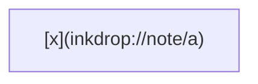

---
inkdrop:
  id: note:self
  title: "Original: title"
  notebook: Projects/Child
  tags:
    - alpha
    - zeta
  status: active
  pinned: true
  created: 2024-01-15T08:30:00.123Z
  updated: 2024-01-16T08:30:00.123Z
---

Inline `[x](inkdrop://note/a)` and math $[x](inkdrop://note/a)$ stay.

$$
\text{inkdrop://note/a}
$$

    indented [x](inkdrop://note/a)

Real link [[Alpha]].

<!-- unresolved: [] -->
